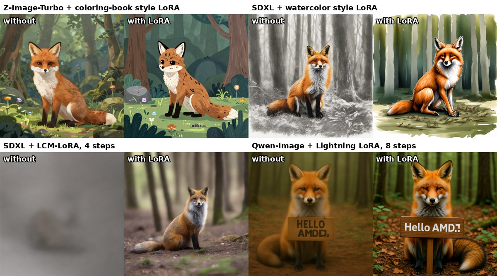

# ComfyUI-nunchaku-rocm

ComfyUI nodes that run [Nunchaku](https://github.com/nunchaku-ai/nunchaku) 4-bit SVDQuant models on AMD GPUs, on
[nunchaku-rocm](https://github.com/TwelveNights/nunchaku-rocm) (Triton kernels, plus native int4 kernels on RDNA3):
FLUX.1, FLUX.2 [klein], Qwen-Image, Z-Image-Turbo and SDXL.

![FLUX.2 [klein] 4B on an RX 7800 XT: stock ComfyUI bf16 10.9 s, this node pack int4 3.0 s](assets/klein-4b-stock-vs-int4.jpg)

![int4 outputs on an RX 7800 XT: FLUX.2 [klein] 4B 2.9 s, FLUX.1-schnell 5.5 s, Z-Image-Turbo 8.4 s, SDXL 10.6 s](assets/int4-outputs-rx7800xt.jpg)

Only the diffusion model is replaced. Text encoders, VAE, sampler and scheduler are ComfyUI's own nodes, so the usual
workflows apply with one node swapped.

| Workflow (1024², warm) | RX 7800 XT 16 GB, Windows 11 |
| --- | --- |
| FLUX.2 [klein] 4B, 4 steps | 2.9 s |
| FLUX.1-schnell, 4 steps | 5.5-5.7 s |
| Z-Image-Turbo, 8 steps | 8.4-8.5 s |
| Qwen-Image Lightning, 8 steps | 11.6 s |
| SDXL, 30 steps | 10.6-10.7 s |

Measurements, VRAM notes and accuracy checks against ComfyUI's bf16 models are in
[nunchaku-rocm's ComfyUI notes](https://github.com/TwelveNights/nunchaku-rocm/blob/main/comfyui/README.md).

## Nodes

Category *Nunchaku (ROCm)*:

- **Nunchaku DiT Loader (ROCm)** loads a Nunchaku checkpoint from `models/diffusion_models` as a `MODEL`. The model
  type is read from the checkpoint. Qwen-Image only: `cpu_offload` (`auto` / `enable` / `disable`) streams the
  transformer blocks from CPU memory, on by default below 20 GiB of VRAM; `num_blocks_on_gpu` keeps more blocks
  resident.
- **Nunchaku LoRA Loader (ROCm)** adds a LoRA to any of these models (chain several for more). ComfyUI's own
  LoraLoader cannot reach the 4-bit layers. See [LoRA](#lora).

## Install

You need ComfyUI running on a ROCm PyTorch, e.g. ComfyUI's **Windows portable for AMD GPUs** or a Linux install with
ROCm PyTorch.

1. Install this node pack with **ComfyUI Manager** (search for "nunchaku rocm"), or clone it into
   `ComfyUI/custom_nodes` and run its `install.py` with ComfyUI's Python
   (`python_embeded\python.exe install.py` on the Windows portable):

   ```
   git clone https://github.com/TwelveNights/ComfyUI-nunchaku-rocm.git
   ```

   `install.py` (Manager runs it for you) installs [nunchaku-rocm](https://pypi.org/project/nunchaku-rocm/) from
   PyPI with your installed `torch` / `torchvision` / `torchaudio` / ROCm packages pinned, so it never replaces your
   PyTorch. On Windows it also adds `triton-windows`, the ROCm SDK devel package matching your ROCm wheels, and the
   Python `include` / `libs` folders the portable build leaves out (Triton compiles against them). It does nothing
   unless PyTorch is a ROCm build.
2. Restart ComfyUI and open an example workflow: *Templates* in the left sidebar, then **Extensions >
   comfyui-nunchaku-rocm** at the bottom of the list (**ComfyUI-nunchaku-rocm** if you cloned it). The same files
   are in [`example_workflows`](example_workflows).

The first image of each model compiles and autotunes kernels and can take a minute or two; later runs use the cache.

Tested from scratch on ComfyUI 0.45's Windows portable for AMD GPUs (PyTorch 2.9.1, ROCm 7.2.1, RX 7800 XT; installed
through ComfyUI-Manager, then as fast as a hand-built install) and on Linux (PyTorch 2.10 for ROCm 7.0, MI300X). With
other ROCm versions on Windows, install the matching ROCm SDK devel wheel yourself (`install.py` says so), or follow
[nunchaku-rocm's install guide](https://github.com/TwelveNights/nunchaku-rocm#install).

## Models

Use the **int4** checkpoints: AMD GPUs have no FP4 matrix units, so NVFP4 files run on a slower emulated path.

The example workflows carry download links for every file they use: open one and ComfyUI lists the missing models
with a **Download** button each (ComfyUI's own panel; in the browser the files go to your downloads folder, so move
them into the `models` folder shown next to each, while ComfyUI Desktop saves them in place). The table lists the
same files. For SDXL, `clip_g.safetensors` from `Comfy-Org/stable-diffusion-3.5-fp8` is SDXL's second text encoder
(identical weights).

| Model | Checkpoint (`models/diffusion_models`) | Text encoder(s) (`models/text_encoders`) | VAE (`models/vae`) |
| --- | --- | --- | --- |
| FLUX.2 [klein] 4B | `tonera/FLUX.2-klein-4B-Nunchaku`: `svdq-int4_r32-…` | `qwen_3_4b.safetensors` (type `flux2`) | `flux2-vae.safetensors` |
| FLUX.2 [klein] 9B | `tonera/FLUX.2-klein-9B-Nunchaku`: `svdq-int4_r32-…` | `qwen_3_8b_fp8mixed.safetensors` (type `flux2`) | `flux2-vae.safetensors` |
| FLUX.1-schnell / dev / Krea / Kontext | `nunchaku-ai/nunchaku-flux.1-schnell` (or `-dev`, `-krea-dev`, `-kontext-dev`): `svdq-int4_r32-…` | `clip_l` + `t5xxl_fp16` (DualCLIPLoader, type `flux`) | `ae.safetensors` |
| Qwen-Image, Lightning | `nunchaku-ai/nunchaku-qwen-image`: `svdq-int4_r32-qwen-image…` | `qwen_2.5_vl_7b_fp8_scaled.safetensors` (type `qwen_image`) | `qwen_image_vae.safetensors` |
| Qwen-Image-Edit, Edit-2509 | `nunchaku-ai/nunchaku-qwen-image-edit` (or `-edit-2509`): `svdq-int4_r32-…` | `qwen_2.5_vl_7b_fp8_scaled.safetensors` (type `qwen_image`) | `qwen_image_vae.safetensors` |
| Z-Image-Turbo | `nunchaku-ai/nunchaku-z-image-turbo`: `svdq-int4_r32-z-image-turbo` | `qwen_3_4b.safetensors` (type `lumina2`) | `ae.safetensors` |
| SDXL, SDXL-Turbo | `nunchaku-ai/nunchaku-sdxl`, `nunchaku-ai/nunchaku-sdxl-turbo` | `clip_l` + `clip_g` (DualCLIPLoader, type `sdxl`) | `sdxl_vae.safetensors` |

Qwen-Image-Edit works with ComfyUI's usual edit nodes (`TextEncodeQwenImageEditPlus` / `ReferenceLatent`).

Not supported yet: ControlNet, Z-Image's reference inputs, the `index_timestep_zero` reference method
(Qwen-Image-Edit-2511), and model-patching nodes that replace transformer blocks or attention (ignored with a
warning).

## LoRA



Put LoRAs in `models/loras` and add **Nunchaku LoRA Loader (ROCm)** between the DiT loader and the sampler; chain one
per LoRA. It reads ComfyUI, kohya (`lora_unet_...`) and diffusers / PEFT LoRA files for FLUX.1, FLUX.2 [klein],
Z-Image, Qwen-Image (with or without CPU offload) and SDXL, including SDXL convolution (LoCon) LoRAs such as
LCM-LoRA. Text-encoder weights in a LoRA file are ignored.

On the 4-bit layers the LoRA is added to their 16-bit low-rank branch, so it costs no extra kernels. Switching LoRAs or
strengths between runs re-applies them in a fraction of a second, and workflow branches with and without LoRAs share
one loaded model.

Checked against ComfyUI's own LoRA loading on the bf16 models (same seed): the images above match the bf16 + LoRA
results in style and composition. The model is quantized to 4 bits, so a LoRA's effect is close to, not identical
with, its effect on the full-precision model; very subtle LoRAs are the least precise.

## License

Apache License 2.0, like Nunchaku and nunchaku-rocm.

## Related

- [ComfyUI-3D-rocm](https://github.com/TwelveNights/ComfyUI-3D-rocm): image to textured 3D model (TripoSG, Hunyuan3D-2.1 Paint) on AMD
- [SageAttention-rocm](https://github.com/TwelveNights/SageAttention-rocm): 8-bit attention for AMD GPUs
